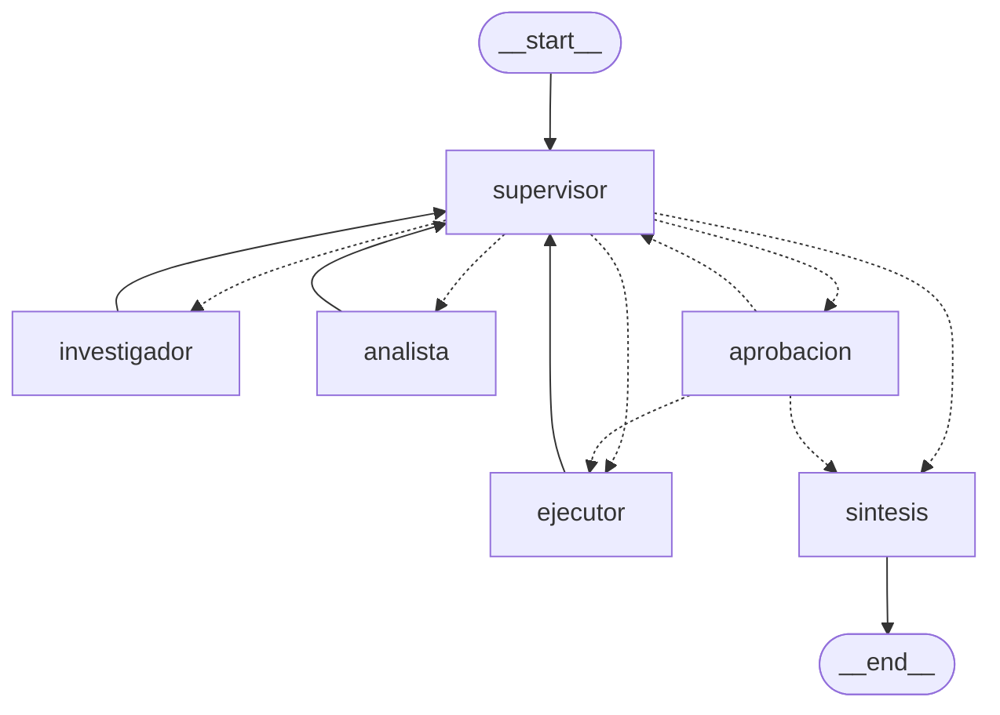

# Sistema Intelligence

Un usuario hace una pregunta sobre las políticas internas de TechCorp. La API encola la tarea y responde al instante con un `job_id`. Un worker corre un grafo de LangGraph: el supervisor decide si hace falta buscar, calcular, pedir aprobación o cerrar; el investigador recupera fragmentos con RAG híbrido; el analista calcula sin `eval`; la síntesis redacta la respuesta. El hilo queda en un Checkpointer. Cada ejecución es una traza en Arize Phoenix.



Las flechas punteadas salen de `enrutar` y de `route_after_approval`. Las llenas son fijas: cada especialista vuelve al supervisor y la síntesis termina. `python diagrama.py` regenera el mismo dibujo en `grafo.mmd` con `get_graph().draw_mermaid()`.

## Cómo se cumple cada requerimiento

| Requerimiento | Cómo se cumple | Dónde |
| --- | --- | --- |
| **Arquitectura y coherencia del sistema** | Una sola compilación del grafo junta las tres capas. El supervisor elige con `with_structured_output(DecisionSupervisor)`. El investigador busca con `buscar_en_politicas_internas` sobre el RAG híbrido (BM25 + vectorial). El analista calcula con `calculadora`. La API no rearma el grafo: encola y el worker llama a `run_graph` / `resume_graph`. | `app/graph.py` · `agents/research_agent.py` · `agents/analyst_agent.py` · `rag.py` · `app/main.py` · `app/worker.py` |
| **Robustez técnica: asincronía y validación** | Los nodos son `async def` y las llamadas al modelo son `ainvoke`, envueltas en `await modelo.invocar` (backoff con `asyncio.sleep`). La búsqueda usa `retriever.ainvoke`. La API y las herramientas validan entrada y salida con Pydantic: `TaskRequest` / `TaskResponse` / `TaskStatus` / `ThreadHistory`, `ConsultaPoliticas` / `ResultadoBusqueda`, `ExpresionCalculo` / `ResultadoCalculo`, `PayrollAdjustment` / `AdjustmentResult`, `Solicitud` y `DecisionSupervisor`. Cada salida de la API tiene `response_model` y el `return` es ese modelo. | `modelo.py` · `app/graph.py` · `rag.py` · `app/main.py` · `app/hitl.py` · `agents/` |
| **Persistencia y observabilidad** | `acompile_graph()` abre `AsyncRedisSaver` (`abrir_redis_saver`: `from_conn_string` + `__aenter__`, que llama a `asetup()`). El `thread_id` va en `configurable` y el historial se lee con `aget_state`. OpenInference instrumenta LangChain (no OpenAI, para no duplicar tokens). Cada ejecución es un span `orquestador` con `session.id` = `thread_id`, y cada llamada al modelo abre `llm.call` con `@trace_llm`. Cinco consultas dejan cinco trazas. | `app/graph.py` · `app/worker.py` · `app/observability.py` · `tests/test_trazas.py` · `pruebas_sistema.py` |
| **Documentación y despliegue** | Este README, el diagrama de arriba y `grafo.mmd`. Una instrucción levanta Redis 8, Phoenix, la API y el worker: `docker compose up --build`, `./run.sh` o `.\run.ps1`. | `README.md` · `grafo.mmd` · `diagrama.py` · `docker-compose.yml` · `run.sh` · `run.ps1` |
| **Configuración de entorno y estándares** | Python 3.12 (`type Orquestador = ...` en `app/graph.py`, PEP 695). `exigir_python_312()` corre antes de importar el grafo. Dependencias pinneadas en `requirements.txt`, incluida `pytest`. El modelo, el índice, el namespace y el embedding salen de variables de entorno, no de un literal en el código. | `requisitos.py` · `main.py` · `.python-version` · `pyproject.toml` · `.env.example` · `modelo.py` · `rag.py` |

## Quick path

> **Requisito: Python 3.12 o superior.** `app/graph.py` declara `type Orquestador = CompiledStateGraph[...]`, el alias `type` de PEP 695, que no existe antes de 3.12. `main.py`, `app/main.py` y `app/worker.py` llaman a `exigir_python_312()` antes de importar el grafo. Con 3.11 el mensaje sale antes del `SyntaxError` (`evidencias/03-python-311.txt`).

**Windows (PowerShell):**

```powershell
py -3.12 -m venv .venv
Set-ExecutionPolicy -Scope Process -ExecutionPolicy Bypass
.\.venv\Scripts\Activate.ps1
pip install -r requirements.txt
Copy-Item .env.example .env
```

**Linux/macOS:**

```bash
python3.12 -m venv .venv
source .venv/bin/activate
pip install -r requirements.txt
cp .env.example .env
```

> **En cada terminal nueva**, antes de `python ...`, activá el venv. La activación (y `Set-ExecutionPolicy -Scope Process`) vale solo para esa terminal:
>
> - Windows: `Set-ExecutionPolicy -Scope Process -ExecutionPolicy Bypass` y `.\.venv\Scripts\Activate.ps1`
> - Linux/macOS: `source .venv/bin/activate`
>
> El prompt empieza con `(.venv)`. Sin activar, usá el intérprete del venv directo: `.\.venv\Scripts\python.exe main.py` (Windows) o `.venv/bin/python main.py`.

En `.env` cargá `LLM_PROVIDER` y la clave de ese proveedor (`OPENAI_API_KEY`, `GOOGLE_API_KEY` o `ANTHROPIC_API_KEY`). El nombre del modelo es `OPENAI_MODEL`, `GOOGLE_MODEL` o `ANTHROPIC_MODEL`. `INDEX_NAME`, `PINECONE_NAMESPACE` y `OPENAI_EMBEDDING_MODEL` solo hacen falta si hay `PINECONE_API_KEY`. Si esa clave queda vacía, el RAG híbrido corre en memoria. `.env` no se versiona.

### Una instrucción

Con Docker en marcha y el `.env` al lado:

```text
docker compose up --build
```

Lo mismo hacen `./run.sh` y `.\run.ps1`. Levantan Redis 8, Phoenix, la API (`WORKER_IN_API=0`) y el worker (`python -m app.worker`). La API queda en http://localhost:8000 y Phoenix en http://localhost:6006. El proyecto de trazas se llama `intelligence` (`PHOENIX_PROJECT`).

Sin Docker, tres terminales con el venv activado:

```text
docker run -d --name redis-intelligence -p 6379:6379 redis:8
python -m phoenix.server.main serve
python main.py
```

`python main.py` arranca la API con el worker adentro (`WORKER_IN_API=1`, el default).

### Chequeo sin clave y sin Redis

```text
python validacion.py
python -m pytest -q
py -3.11 main.py
python diagrama.py
```

`validacion.py` y `pytest` no llaman a la API ni abren Redis. El doble del modelo está en `tests/conftest.py`, y el de la demo, en `validacion.py`.

## Probar una tarea

**Windows (PowerShell):**

```powershell
$body = @{ query = "¿Cuántos días de vacaciones corresponden con 5 años de antigüedad?" } | ConvertTo-Json
$task = Invoke-RestMethod -Method Post -Uri http://localhost:8000/tasks -ContentType "application/json; charset=utf-8" -Body ([Text.Encoding]::UTF8.GetBytes($body))
$task
Invoke-RestMethod http://localhost:8000/tasks/$($task.job_id)
```

En PowerShell, `Invoke-RestMethod` arma el JSON sin pelear con las comillas, y el cuerpo va como bytes UTF-8 para que los acentos lleguen bien. Repetí la última línea hasta ver `DONE`.

**Linux/macOS:**

```bash
curl -X POST localhost:8000/tasks -H "Content-Type: application/json" -d '{"query": "¿Cuántos días de vacaciones corresponden con 5 años de antigüedad?"}'
curl localhost:8000/tasks/<job_id>
```

El POST vuelve enseguida con `job_id`, `thread_id` y `"status": "PENDING"`. El GET no corre el agente: lee Redis. El ciclo es `PENDING`, `RUNNING` y `DONE`. Si el worker lanza una excepción, el job queda `FAILED` con el mensaje en `error`.

Para seguir la conversación, mandá el `thread_id` anterior. `GET /threads/{thread_id}` lee los mensajes del Checkpointer. Un hilo con un job en curso responde 409.

La demo, con la API levantada:

```text
python demo_api.py hilo
```

## Cinco pruebas y las trazas

Con Redis, Phoenix y la API levantados:

```text
python carga.py
python metricas.py
python pruebas_sistema.py
```

`carga.py` manda 5 `POST /tasks` a la vez, comprueba que vuelven en menos de un segundo y espera `DONE`. `pruebas_sistema.py` corre las mismas cinco preguntas dentro del span `orquestador`. En la corrida guardada el checkpointer fue `AsyncRedisSaver en redis://localhost:6379`, Phoenix respondió `traceCount=5` y `spans_orquestador=5`, y Redis quedó con checkpoints `checkpoint:prueba-1` … `checkpoint:prueba-5` (`evidencias/05-pruebas-phoenix.txt`). La de los 12 años da 231 días. `tests/test_trazas.py::test_cinco_ejecuciones_dejan_cinco_trazas` exige las cinco trazas sin red.

Cada ejecución es una sola traza `orquestador`, con `session.id` igual al `thread_id`. La telemetría de FastAPI excluye `/tasks` y `/threads`: un GET de polling de 2 ms no entra en el percentil ni en el costo.

`OpenAIInstrumentor` no se activa junto con `LangChainInstrumentor`: cada llamada aparecería dos veces y Phoenix duplicaría tokens y costo. Lo exige `tests/test_observabilidad.py::test_langchain_instrumentado_y_openai_no`.

## Aprobación humana

Hay dos razones para pausar, las dos con `interrupt` en el nodo `aprobacion`:

- **Efecto secundario.** Si la consulta pide registrar un ajuste de nómina, el supervisor manda a `aprobacion` antes de `register_payroll_adjustment`. El GET pasa a `AWAITING_APPROVAL` y el `interrupt` dice `"reason": "side-effect tool register_payroll_adjustment"`.
- **Costo muy alto.** Cada nodo suma los tokens (`get_usage_metadata_callback`). Si el costo estimado pasa `COSTO_MAXIMO_USD` (por defecto 0,01 USD), el supervisor pausa con `"reason": "estimated cost above COSTO_MAXIMO_USD"`.

```bash
curl -X POST localhost:8000/tasks/<job_id>/approve -H "Content-Type: application/json" -d '{"approved": true}'
```

El POST vuelve al instante con `"status": "RUNNING"`. Con `approved: false` el grafo cierra sin el paso pausado. El endpoint vive en `app/hitl.py`.

## Topología

```python
def enrutar(state: AgentState) -> Literal["investigador", "analista", "aprobacion", "ejecutor", "sintesis"]:
    if state["next_agent"] == "FINISH":
        return "sintesis"
    ...

grafo = StateGraph(AgentState)
grafo.add_node("supervisor", medido(nodo_supervisor))
grafo.add_node("investigador", medido(con_contexto(nodo_investigador)))
grafo.add_node("analista", medido(con_tarea(nodo_analista)))
grafo.add_node("aprobacion", approval_node)
grafo.add_node("ejecutor", executor_node)
grafo.add_node("sintesis", medido(nodo_sintesis))
grafo.add_edge(START, "supervisor")
grafo.add_conditional_edges("supervisor", enrutar, {...})
grafo.add_edge("investigador", "supervisor")
grafo.add_edge("analista", "supervisor")
grafo.add_conditional_edges("aprobacion", route_after_approval, {...})
grafo.add_edge("ejecutor", "supervisor")
grafo.add_edge("sintesis", END)
```

El grafo se arma una sola vez. `main.py` no lo vuelve a armar.

El orden se conoce: sin el dato de la política no hay cuenta, y sin la cuenta no hay respuesta. Los especialistas no se hablan entre sí. `aplicar_guardas` no deja un `FINISH` sin búsqueda ni, si la pregunta pide una cuenta (`total`, `acumul`, `calcul`, `suma`, ...), sin cálculo. Tampoco repite a quien ya cumplió. `MAX_PASOS = 6` corta aunque el modelo insista. `recursion_limit` (25 por defecto) llega al `ainvoke`.

`k`, `chunk_size` y `chunk_overlap` son defaults (`5`, `600`, `100`) y llegan al splitter y a los dos retrievers en cada consulta. Lo cubre `tests/test_herramientas.py::test_k_y_el_tamano_de_chunk_llegan_al_splitter`.

## Estado

`AgentState` hereda `messages`. `contribuciones` usa `operator.add`: cada nodo agrega la suya. Lo propio de un turno (contribuciones y tokens) se reinicia con `Overwrite` para que un seguimiento no arrastre el cálculo anterior. `messages` sí se acumula en el hilo.

## Archivos

| Artefacto | Dónde está |
| --- | --- |
| `POST /tasks`, `GET /tasks/{job_id}`, `GET /threads/{thread_id}` con `response_model` | `app/main.py` |
| `TaskRequest`, `TaskResponse`, `TaskStatus`, `ThreadHistory` | `app/main.py` |
| Grafo, `DecisionSupervisor`, `AsyncRedisSaver`, `ainvoke` | `app/graph.py` |
| Worker `PENDING` / `RUNNING` / `AWAITING_APPROVAL` / `FAILED` / `DONE` | `app/worker.py` |
| OpenInference, `LangChainInstrumentor`, `trace_llm` | `app/observability.py` |
| `interrupt`, `POST /tasks/{job_id}/approve`, `PayrollAdjustment` | `app/hitl.py` |
| `buscar_en_politicas_internas`, `ConsultaPoliticas`, `ResultadoBusqueda` | `agents/research_agent.py` |
| `calculadora`, `ExpresionCalculo`, `ResultadoCalculo` | `agents/analyst_agent.py` |
| RAG híbrido, `obtener_top_k` async | `rag.py`, `data/` |
| LLM, `invocar`, familias 401 / 429 / red | `modelo.py`, `errors.py` |
| Guardia Python 3.12 | `requisitos.py` |
| Cinco POST concurrentes | `carga.py` |
| Cinco consultas y el proyecto en Phoenix | `pruebas_sistema.py` |
| Métricas que calcula Phoenix | `metricas.py` |
| Demo contra la API | `demo_api.py` |
| Demo sin clave | `validacion.py` |
| Diagrama | `diagrama.py`, `grafo.mmd` |
| Tests | `tests/` |
| Redis 8 + Phoenix + API + worker | `docker-compose.yml`, `Dockerfile`, `run.sh`, `run.ps1` |

## Errores

### Sin el venv activado

Mensaje, al final del traceback:

```text
ModuleNotFoundError: No module named 'fastapi'
```

`python` es el intérprete global, que no tiene las dependencias de `requirements.txt`. Si ese Python es anterior a 3.12, en lugar de este error sale el de la guardia (`Python 3.12+ requerido`).

Cómo reproducirlo: abrir una terminal nueva en la carpeta del repo y correr `python main.py` sin activar el venv.

Solución: activar el venv en esa terminal, o llamar al intérprete del venv directo.

### JSON cortado en PowerShell

Mensaje, al usar `curl.exe` con el JSON entre comillas dobles y `\"`:

```text
{"detail":[{"type":"json_invalid","loc":["body",1],"msg":"JSON decode error","input":{},"ctx":{"error":"Expecting property name enclosed in double quotes"}}]}
```

En PowerShell la barra invertida no escapa comillas. La cadena se corta y la API recibe un JSON roto (422). Solución: los ejemplos de PowerShell de este README, con `Invoke-RestMethod`.

Las respuestas declaran `Content-Type: application/json; charset=utf-8`. Sin el `charset`, Windows PowerShell 5.1 lee la respuesta como Latin-1. Lo cubre `tests/test_api.py::test_las_respuestas_json_declaran_utf8`.

### 401/key

Mensaje, si falta la variable:

```text
401/key: falta OPENAI_API_KEY en las variables de entorno. Copiá .env.example a .env y cargá la clave. No se reintenta.
```

Si la clave está y el proveedor la rechaza:

```text
401/key: el proveedor rechazó la API key. No se reintenta: revisá la clave en .env.
```

No se reintenta. Si ocurre dentro del worker, el job queda `FAILED` con ese texto.

Cómo reproducirlo: `python -m pytest tests/test_errores.py::test_falta_la_clave_401 tests/test_errores.py::test_401_no_se_reintenta -q`. El caso en segundo plano lo cubre `tests/test_api.py::test_401_en_segundo_plano_queda_failed`.

### 429/cuota

Mensaje:

```text
429/cuota: el proveedor limitó las llamadas (rate limit o cuota). Detalle: RateLimitError: Rate limit reached
```

`invocar` reintenta con backoff (0,5 s y 1 s, `asyncio.sleep`). Si se agotan los 3 intentos, el mensaje es el del último fallo, más ` (reintentos agotados: 3 intentos; probá de nuevo en unos segundos)`.

Cómo reproducirlo: `python -m pytest tests/test_errores.py::test_429_es_cuota_y_reintenta tests/test_errores.py::test_429_agotado_usa_el_ultimo_fallo tests/test_errores.py::test_backoff_duplica_la_espera -q`.

### red/timeout

Mensaje:

```text
red/timeout: no se pudo hablar con el proveedor del LLM. Detalle: TimeoutError: timed out
```

También se reintenta. Una 401 no entra en esta familia.

Cómo reproducirlo: `python -m pytest tests/test_errores.py::test_timeout_es_red -q`.

### Output truncado

Mensaje, como aporte del investigador:

```text
ERROR: output truncado: investigador cortó la respuesta por max_tokens. Pedile una respuesta más corta.
```

`es_truncada` mira `finish_reason == "length"`. Ese aporte no cuenta como tarea cumplida. El job no pasa a `FAILED` por esto: el supervisor sigue.

Cómo reproducirlo: `python -m pytest tests/test_grafo.py::test_respuesta_truncada_no_se_toma_como_dato -q`.

### Solicitud inválida

En el grafo, antes de gastar una llamada:

```text
Solicitud inválida: texto: String should have at least 1 character
```

En la API, la misma query en blanco responde 422:

```text
{"detail":[{"type":"string_too_short","loc":["body","query"],"msg":"String should have at least 1 character","input":"   ","ctx":{"min_length":1}}]}
```

La herramienta de búsqueda, con una pregunta vacía, no adivina: devuelve cómo seguir (`Pasá la pregunta con texto, por ejemplo 'días de vacaciones por antigüedad'.`). La calculadora vacía pide una expresión (`5*14 + 5*21 + 2*28`). La observación que vuelve al modelo es siempre un `str`, después de validar la salida con Pydantic.

Cómo reproducirlo: `python -m pytest tests/test_errores.py::test_pregunta_vacia_no_llega_al_grafo tests/test_api.py::test_http_job_inexistente_y_body_invalido tests/test_herramientas.py -q`.

### Falta el nombre del modelo o del índice

```text
Falta OPENAI_MODEL. Definila en .env: el nombre del modelo no está clavado en el código.
```

```text
Falta INDEX_NAME. Definila en .env (ver .env.example). No hay un valor clavado en el código.
```

`INDEX_NAME`, `PINECONE_NAMESPACE` y `OPENAI_EMBEDDING_MODEL` se leen solo al conectar Pinecone. El camino en memoria no los necesita.

Cómo reproducirlo: `LLM_PROVIDER=openai`, `OPENAI_API_KEY` presente y `OPENAI_MODEL` ausente, y llamar a `modelo.crear_llm()`.

### Job que no existe

```text
{"detail":"Job not found"}
```

`GET /tasks/{job_id}` y `POST /tasks/{job_id}/approve` responden 404. Cómo reproducirlo: `python -m pytest tests/test_api.py::test_job_inexistente_responde_404 tests/test_api.py::test_approve_de_un_job_inexistente_responde_404 -q`.

### Hilo que no existe

```text
{"detail":"Thread not found"}
```

`GET /threads/{thread_id}` responde 404 si el Checkpointer no tiene ese hilo. Cómo reproducirlo: `python -m pytest tests/test_hilos.py::test_hilo_inexistente_responde_404 -q`.

### Hilo ocupado

```text
{"detail":"Thread is busy"}
```

`POST /tasks` con un `thread_id` que todavía tiene un job en `PENDING`, `RUNNING` o `AWAITING_APPROVAL` responde 409. Cómo reproducirlo: `python -m pytest tests/test_hilos.py::test_un_hilo_ocupado_responde_409 -q`.

### Approve sin pausa

```text
{"detail":"Job is not awaiting approval"}
```

El job existe pero no está en `AWAITING_APPROVAL`. Responde 409. Cómo reproducirlo: `python -m pytest tests/test_api.py::test_approve_sin_pausa_responde_409 -q`.

### El worker falla

```text
{"status": "FAILED", "error": "corte de prueba"}
```

La excepción queda en `error`, el hilo se libera y el bucle sigue. Cómo reproducirlo: `python -m pytest tests/test_api.py::test_el_worker_guarda_failed_y_sigue -q`.

### Job interrumpido por un reinicio

```text
{"status": "FAILED", "error": "worker restarted before the job finished"}
```

Si el proceso muere con un job en `RUNNING`, al arrancar pasa a `FAILED`. Los jobs en `AWAITING_APPROVAL` no se tocan: el checkpoint sigue en Redis y el approve los reanuda. Cómo reproducirlo: `python -m pytest tests/test_worker_proceso.py::test_running_huerfano_pasa_a_failed -q`.

### Redis caído al arrancar

```text
Redis is unavailable at redis://localhost:6379. Start it with: docker compose up
```

Cómo reproducirlo: `python -m pytest tests/test_worker_proceso.py::test_redis_caido_al_arrancar_dice_que_hacer -q`.

### Redis caído con la API levantada

```text
{"detail":"Redis is unavailable"}
```

`POST /tasks`, `GET /tasks/{job_id}`, `GET /threads/{thread_id}` y el approve responden 503. Nada se encola. Cómo reproducirlo: `python -m pytest tests/test_api.py::test_redis_caido_despues_de_arrancar_es_503 -q`.

### Decisión ilegible

```text
Decisión inválida del supervisor:
```

Si la salida estructurada no es `DecisionSupervisor`, no se inventa una ruta. Cómo reproducirlo: `python -m pytest tests/test_errores.py::test_decision_ilegible_no_inventa_ruta -q`.

### LLM_PROVIDER inválido

```text
LLM_PROVIDER inválido: 'otro'. Valores soportados: google, openai, anthropic.
```

Cómo reproducirlo: `python -m pytest tests/test_errores.py::test_provider_invalido -q`.

### Índice incompatible

```text
Mismatch de dimensiones: el índice <INDEX_NAME> es <N>D y <OPENAI_EMBEDDING_MODEL> usa 1536D. No se reingesta.
```

Si el índice ya existe con otra dimensión o con una métrica distinta de cosine, no se recrea ni se reingesta. La excepción es `IndiceIncompatibleError` y no se reintenta.

## Evidencias

| Archivo | Qué muestra |
| --- | --- |
| `evidencias/01-validacion.txt` | Sin clave y sin Redis: 401/key, 429, red/timeout, guardia 3.11, dos turnos en un hilo, pausa por costo, pausa por efecto secundario con approve, 404, 409, 422, 503, `FAILED`, un job huérfano y Redis caído al arrancar. `git ls-files` no lista `.env`. |
| `evidencias/02-pytest.txt` | 98 passed. |
| `evidencias/03-python-311.txt` | `py -3.11 main.py` corta con el mensaje de la guardia. |
| `evidencias/04-diagrama.txt` | La salida de `python diagrama.py`. |
| `evidencias/05-pruebas-phoenix.txt` | Cinco consultas con `AsyncRedisSaver`, Pinecone y Phoenix: `traceCount=5`, `spans_orquestador=5`. La de los 12 años da 231 días. |

## Checklist

- [x] El grafo une RAG, supervisor, analista, síntesis y la API. Se compila una sola vez.
- [x] Nodos y llamadas al modelo en `async`/`await` (`ainvoke`). El backoff usa `asyncio.sleep`.
- [x] Pydantic en la API (`response_model` y `return` del modelo) y en las herramientas (entrada y salida). `HTTPException` con `detail`.
- [x] Checkpointer `AsyncRedisSaver`. El historial se lee con `aget_state` y sobrevive en Redis.
- [x] OpenInference hacia Phoenix. Cinco ejecuciones reales, `traceCount=5` y cinco spans `orquestador` (`evidencias/05-pruebas-phoenix.txt`). El mismo contrato, sin red, está en `tests/test_trazas.py`.
- [x] Diagrama del grafo en este README y en `grafo.mmd`.
- [x] `docker compose up --build`, `run.sh` y `run.ps1`.
- [x] Python 3.12, `requirements.txt` con `pytest` y `pytest-asyncio`, variables en `.env.example`. Sin índice ni modelo clavados en el código.
- [x] `python validacion.py` y `python -m pytest -q` en verde, sin pegarle a la API real.
