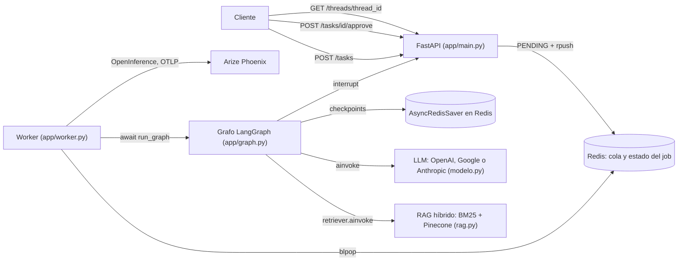
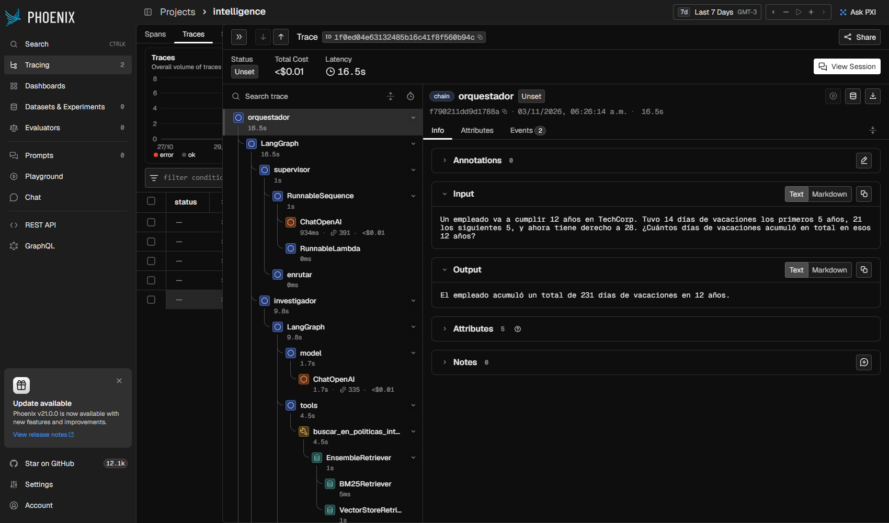
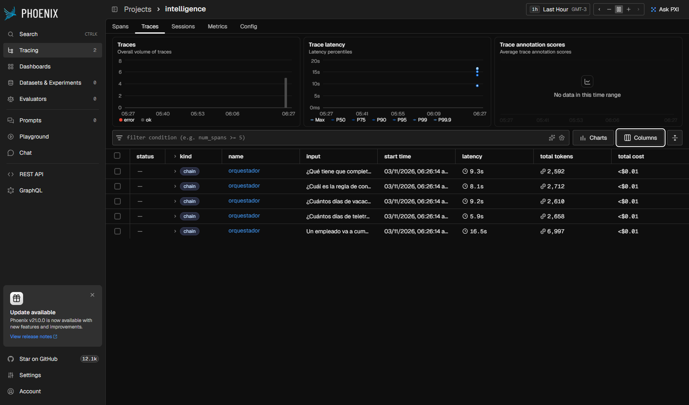
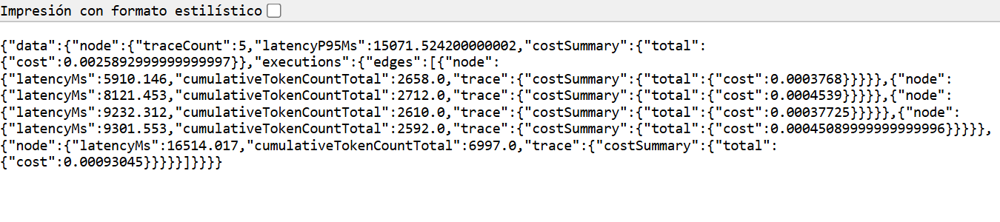
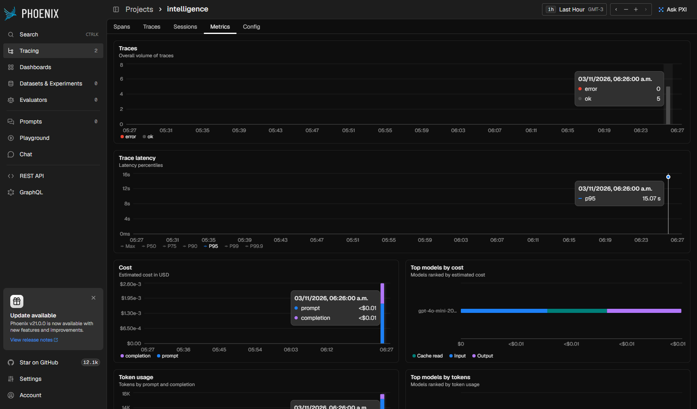
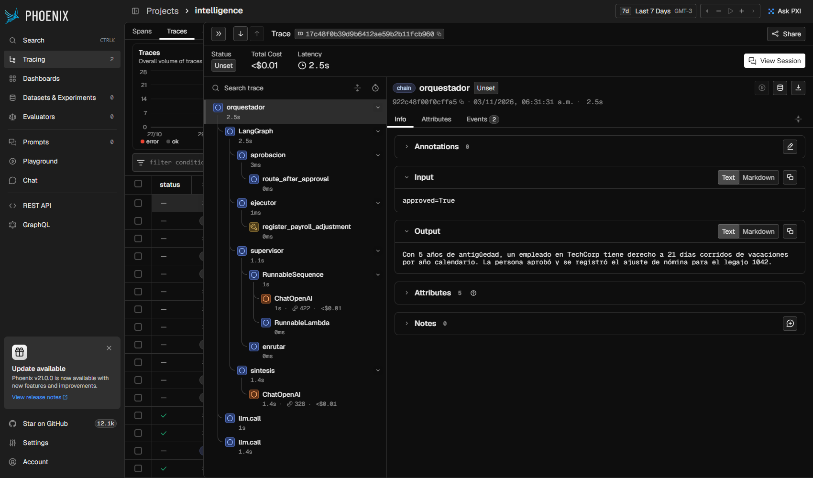
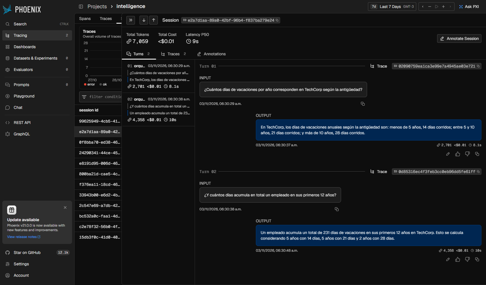

# Sistema Intelligence

Un usuario hace una pregunta sobre las políticas internas de TechCorp. La API encola la tarea y responde al instante con un `job_id`. Un worker corre un grafo de LangGraph: el supervisor decide si hace falta buscar, calcular, pedir aprobación o cerrar; el investigador recupera fragmentos con RAG híbrido; el analista calcula sin `eval`; la síntesis redacta la respuesta. El hilo queda en un Checkpointer. Cada ejecución es una traza en Arize Phoenix.

## Arquitectura



La API no corre el grafo: valida el pedido con Pydantic, deja el job en `PENDING` y lo encola en Redis. El worker lo toma con `blpop` y espera el grafo con `await`. Los nodos llaman al LLM con `ainvoke` y el investigador consulta el RAG con `retriever.ainvoke`. Cada paso del grafo se guarda en `AsyncRedisSaver`, así que el hilo sigue ahí después de reiniciar la API o el worker. Una pausa por aprobación (`interrupt`) se retoma con `POST /tasks/{job_id}/approve`. Cada ejecución sale hacia Phoenix como una traza `orquestador`, con `session.id` igual al `thread_id`.

## Grafo de agentes


Las flechas punteadas salen de `enrutar` y de `route_after_approval`. Las llenas son fijas: cada especialista vuelve al supervisor y la síntesis termina. `python diagrama.py` regenera el mismo dibujo en `grafo.mmd` con `get_graph().draw_mermaid()`.

## Cómo se cumple cada requerimiento

Cada criterio de evaluación, con los entregables de la consigna que cubre, la línea de código que lo cumple y la evidencia de una corrida real.

### Arquitectura y coherencia del sistema

Entregable: **Integración de Código**. La lógica de los módulos 6 y 7 vive en una sola estructura de proyecto:

- **Del módulo 6** (orquestador multi-agente): supervisor, investigador, analista y síntesis (`app/graph.py`, `agents/`), RAG híbrido (`rag.py`, `data/`), creación del LLM y familias de error (`modelo.py`, `errors.py`) y estado compartido (`state.py`).
- **Del módulo 7** (API de producción): FastAPI (`app/main.py`), worker con cola en Redis (`app/worker.py`), aprobación humana (`app/hitl.py`), trazas hacia Phoenix (`app/observability.py`), `carga.py`, `metricas.py`, `capturas.py`, `demo_api.py` y Docker.
- **Nuevo en esta entrega**: el Checkpointer pasa a `AsyncRedisSaver` (en el módulo 7 era `RedisSaver`, síncrono, y el grafo corría en `to_thread`), el worker espera el grafo con `await`, `pruebas_sistema.py` deja las cinco trazas, `run.sh` y `run.ps1` levantan todo, y el compose tiene volúmenes para Redis y Phoenix.

Líneas que lo cumplen:

- `app/graph.py:392` `return grafo.compile(checkpointer=checkpointer)`. Una sola compilación; `main.py` y la API no vuelven a armar el grafo.
- `app/graph.py:219` `modelo.obtener_llm().with_structured_output(DecisionSupervisor)`. El supervisor delega en `investigador`, `analista`, `aprobacion` o `FINISH`.
- `rag.py:245` `EnsembleRetriever(retrievers=[retriever_bm25, retriever_vectorial], weights=[0.5, 0.5])`, con `rag.py:244` `vectorstore.as_retriever(search_kwargs={"k": k, "namespace": espacio})` sobre Pinecone.
- `agents/research_agent.py:57` `@tool(args_schema=ConsultaPoliticas)` y `agents/analyst_agent.py:81` `@tool(args_schema=ExpresionCalculo)`: las herramientas de cada especialista.
- `app/worker.py:248` `await _client().blpop(QUEUE_NAME, timeout=0)` y `app/worker.py:184` `_graph().run_graph`: la API encola y el worker corre el grafo.

Evidencia: `evidencias/06-compose.txt` (POST y GET contra la API levantada con Docker) y `evidencias/05-pruebas-phoenix.txt` (`RAG: Pinecone índice=techcorp-rag-hibrido namespace=politicas-internas`).

### Robustez técnica: asincronía y validación

Entregables: **Refactorización** (toda la comunicación con LLMs y bases de datos es `async`/`await`) y **Validación** (Pydantic en las entradas y salidas de la API y de las herramientas).

- Nodos `async def`: `app/graph.py:194` `nodo_supervisor`, `agents/research_agent.py:91` `nodo_investigador`, `agents/analyst_agent.py:142` `nodo_analista`, `app/graph.py:321` `nodo_sintesis`.
- LLM: `agents/research_agent.py:96` `lambda: agente.ainvoke(...)`, envuelto en `await modelo.invocar`. El backoff espera con `modelo.py:147` `await asyncio.sleep(...)`.
- Base vectorial: `rag.py:120` `docs = await self.retriever.ainvoke(query)`. El armado del índice (cliente síncrono de Pinecone y lectura de `data/`) sale del event loop con `rag.py:267` `await asyncio.to_thread(construir_rag)`.
- Redis: `app/worker.py:277` `aioredis.from_url(...)` (`redis.asyncio`) y `app/graph.py:384` `AsyncRedisSaver.from_conn_string(destino)`. El grafo corre con `app/graph.py:478` `await get_graph().ainvoke(...)`.
- No hay `requests` en el proyecto. Los scripts que llaman a la API o a Phoenix desde `async def` usan `httpx.AsyncClient`.
- API: `app/main.py:33` `class TaskRequest(BaseModel)` valida la entrada; cada salida declara `response_model` (`app/main.py:109`, `:121`, `:133`, `app/hitl.py:80`) y hace `return` de ese modelo. `status` es un `Literal` (`worker.JobStatus`): un estado inventado no pasa.
- Herramientas, entrada: `args_schema` en `agents/research_agent.py:57`, `agents/analyst_agent.py:81` y `app/hitl.py:67`. Salida: `ResultadoBusqueda` (`agents/research_agent.py:37`), `ResultadoCalculo` (`agents/analyst_agent.py:45`) y `AdjustmentResult` (`app/hitl.py:45`). El ejecutor llama a `app/hitl.py:128` `await register_payroll_adjustment.ainvoke(...)`, así que el `args_schema` valida también la acción aprobada.
- Grafo: `state.py:39` `texto: str = Field(min_length=1, max_length=4000)` en `Solicitud` valida la pregunta antes de gastar una llamada, y la decisión del supervisor es un `DecisionSupervisor`.

Evidencia: `evidencias/02-pytest.txt` (106 passed), `evidencias/11-mypy.txt` (mypy strict sin errores) y `evidencias/01-validacion.txt` (422 con la query en blanco).

### Persistencia y observabilidad

Entregables: **Persistencia** (Checkpointer de LangGraph; las conversaciones no se pierden al reiniciar) y **Observabilidad** (al menos 5 pruebas con trazas visibles en Arize Phoenix).

- `app/graph.py:398` `checkpointer = await abrir_redis_saver()`, que abre `AsyncRedisSaver.from_conn_string` (`app/graph.py:384`). `__aenter__` llama a `asetup()` y crea los índices en Redis.
- `app/worker.py:129` `return {"configurable": {"thread_id": thread_id}, "tags": ["intelligence"]}`: cada job corre en su hilo. `app/graph.py:493` `await get_graph().aget_state(...)` lee el historial para `GET /threads/{thread_id}`.
- `docker-compose.yml:5` `command: ["redis-server", "--appendonly", "yes"]` y `docker-compose.yml:9` `redis-data:/data`: Redis escribe a disco, y el hilo sobrevive a `docker compose restart` y a `docker compose down` + `up` (sin `-v`).
- `app/observability.py:106` `LangChainInstrumentor().instrument(tracer_provider=provider)` y `:107` `PineconeInstrumentor().instrument(...)`, exportados por OTLP a Phoenix (`:92`).
- `app/worker.py:137` `using_session(thread_id)` y `:138` `start_as_current_span("orquestador")`: una traza por ejecución, agrupada por sesión. `app/observability.py:37` abre `llm.call` en cada llamada al modelo.

Evidencia: `evidencias/09-reinicio.txt` (el hilo después de `restart`, después de `down` + `up`, y una aprobación pendiente que se aprueba después de reiniciar), `evidencias/05-pruebas-phoenix.txt` (`traceCount=5`, `spans_orquestador=5` y checkpoints `checkpoint:prueba-1` … `prueba-5`), `evidencias/07-carga.txt`, `evidencias/08-metricas.txt` y las capturas de [Trazas en Phoenix](#trazas-en-phoenix).

### Documentación y despliegue

Entregables: **README** con el diagrama de flujo del grafo de agentes y **Despliegue Local** con una sola instrucción.

- Este README: [Arquitectura](#arquitectura), [Grafo de agentes](#grafo-de-agentes), una sección por familia de error, evidencias y checklist. `python diagrama.py` regenera `grafo.mmd` con `get_graph().draw_mermaid()`.
- `docker compose up --build` levanta Redis 8, Phoenix, la API y el worker. `./run.sh` y `.\run.ps1` hacen lo mismo y, si falta, crean el `.env` desde `.env.example`.

Evidencia: `evidencias/06-compose.txt` y `evidencias/04-diagrama.txt`.

### Configuración de entorno y estándares de código

- **Python 3.12+**: `app/graph.py:378` `type Orquestador = CompiledStateGraph[...]` (alias `type`, PEP 695). La guardia `main.py:5` `exigir_python_312()` corre antes de importar el grafo. `.python-version` es `3.12`, `pyproject.toml:5` `requires-python = ">=3.12"` y `Dockerfile:1` `FROM python:3.12-slim`.
- **Dependencias**: versiones fijadas en `requirements.txt`, con `pytest` y `pytest-asyncio`. La imagen de Phoenix es la misma versión que el paquete (`docker-compose.yml:17` `arizephoenix/phoenix:version-20.23.0`); lo exige `tests/test_entorno.py::test_el_compose_persiste_redis_y_phoenix`.
- **Variables de entorno**: el modelo, el índice, el namespace, el embedding y su dimensión, la región de Pinecone, los precios por token, el límite de costo, el `recursion_limit` y las URLs de Redis y Phoenix salen de `.env` (ver [Variables de entorno](#variables-de-entorno)). `modelo.py:33` `resolver_modelo` y `rag.py:71` `_exigir_entorno("INDEX_NAME")` cortan con un mensaje si falta una.
- **Estándares**: `mypy --strict` sin errores sobre el código de producción, tipos nativos (`list[...]`, `X | None`) y tests con dobles: ninguno llama a la API real.

Evidencia: `evidencias/03-python-311.txt` y `evidencias/11-mypy.txt`.

### Errores comunes evitados

- **Hard-coding**: ningún ID de índice ni nombre de modelo está en el código. `INDEX_NAME`, `PINECONE_NAMESPACE`, `OPENAI_EMBEDDING_MODEL`, `EMBEDDING_DIM`, `PINECONE_CLOUD`, `PINECONE_REGION` y `OPENAI_MODEL` (o `GOOGLE_MODEL`, `ANTHROPIC_MODEL`) vienen del entorno. Lo cubren `tests/test_entorno.py::test_conectar_pinecone_pasa_el_entorno_a_la_libreria` y `tests/test_errores.py::test_crea_chat_openai_con_los_parametros`.
- **Sincronicidad**: dentro de `async def` no hay llamadas bloqueantes de red. El LLM va por `ainvoke`, Redis por `redis.asyncio`, el Checkpointer por `AsyncRedisSaver`, y el cliente síncrono de Pinecone se arma en `asyncio.to_thread`. Lo exigen `tests/test_entorno.py::test_sin_requests_y_pinecone_fuera_del_loop` y `tests/test_contrato.py::test_el_worker_cubre_el_ciclo_y_no_bloquea_el_loop` (el worker no usa `to_thread`: espera el grafo).
- **Falta de trazas**: cada ejecución es una traza `orquestador` con el árbol completo (supervisor, investigador con el retriever, analista, síntesis, aprobación). Ver [Trazas en Phoenix](#trazas-en-phoenix).
- **Alcance del despliegue**: local, con Docker Compose o `run.sh`. No hay CI/CD ni infraestructura en la nube.

## Quick path

> **Requisito: Python 3.12 o superior.** `app/graph.py` declara `type Orquestador = CompiledStateGraph[...]`, el alias `type` de PEP 695, que no existe antes de 3.12. `main.py`, `app/main.py` y `app/worker.py` llaman a `exigir_python_312()` antes de importar el grafo. Con 3.11 el mensaje sale antes del `SyntaxError` (`evidencias/03-python-311.txt`).

**Windows (PowerShell):**

```powershell
py -3.12 -m venv .venv
Set-ExecutionPolicy -Scope Process -ExecutionPolicy Bypass
.\.venv\Scripts\Activate.ps1
pip install -r requirements.txt
Copy-Item .env.example .env
```

**Linux/macOS:**

```bash
python3.12 -m venv .venv
source .venv/bin/activate
pip install -r requirements.txt
cp .env.example .env
```

> **En cada terminal nueva**, antes de `python ...`, activá el venv. La activación (y `Set-ExecutionPolicy -Scope Process`) vale solo para esa terminal:
>
> - Windows: `Set-ExecutionPolicy -Scope Process -ExecutionPolicy Bypass` y `.\.venv\Scripts\Activate.ps1`
> - Linux/macOS: `source .venv/bin/activate`
>
> El prompt empieza con `(.venv)`. Sin activar, usá el intérprete del venv directo: `.\.venv\Scripts\python.exe main.py` (Windows) o `.venv/bin/python main.py`.

En `.env` cargá `LLM_PROVIDER` y la clave de ese proveedor (`OPENAI_API_KEY`, `GOOGLE_API_KEY` o `ANTHROPIC_API_KEY`). El nombre del modelo es `OPENAI_MODEL`, `GOOGLE_MODEL` o `ANTHROPIC_MODEL`. `INDEX_NAME`, `PINECONE_NAMESPACE` y `OPENAI_EMBEDDING_MODEL` solo hacen falta si hay `PINECONE_API_KEY`. Si esa clave queda vacía, el RAG híbrido corre en memoria. `.env` no se versiona.

### Variables de entorno

Todas están en `.env.example`. Ninguno de estos valores está clavado en el código: donde hay default, es el que se usa si la variable no está.

| Variable | Para qué | Default |
| --- | --- | --- |
| `LLM_PROVIDER` | `openai`, `google` o `anthropic` | `google` |
| `OPENAI_API_KEY` / `GOOGLE_API_KEY` / `ANTHROPIC_API_KEY` | Clave del proveedor elegido | (obligatoria: si falta, `401/key`) |
| `OPENAI_MODEL` / `GOOGLE_MODEL` / `ANTHROPIC_MODEL` | Nombre del modelo | (obligatorio: si falta, `Falta OPENAI_MODEL`) |
| `PINECONE_API_KEY` | Activa Pinecone; vacía, el RAG corre en memoria | vacía |
| `INDEX_NAME`, `PINECONE_NAMESPACE`, `OPENAI_EMBEDDING_MODEL` | Índice, namespace y embedding de Pinecone | (obligatorias con Pinecone) |
| `EMBEDDING_DIM` | Dimensión del embedding y del índice | `1536` |
| `PINECONE_CLOUD`, `PINECONE_REGION` | Dónde crear el índice serverless si no existe | `aws`, `us-east-1` |
| `REDIS_URL` | Cola, estado de los jobs y Checkpointer | `redis://localhost:6379` |
| `PHOENIX_ENDPOINT`, `PHOENIX_PROJECT` | Colector OTLP y proyecto de Phoenix | `http://localhost:6006/v1/traces`, `intelligence` |
| `WORKER_IN_API` | `1`: el worker corre dentro de la API; `0`: aparte | `1` |
| `COSTO_MAXIMO_USD` | Costo estimado que dispara la pausa | `0.01` |
| `PRECIO_ENTRADA_USD_1M`, `PRECIO_SALIDA_USD_1M` | Precio del modelo por millón de tokens, para esa estimación | `0.15`, `0.60` |
| `RECURSION_LIMIT` | Tope de pasos de LangGraph en cada `ainvoke` | `25` |

### Una instrucción

Con Docker en marcha y el `.env` al lado:

```text
docker compose up --build
```

Lo mismo hacen `./run.sh` y `.\run.ps1`. Levantan Redis 8, Phoenix, la API (`WORKER_IN_API=0`) y el worker (`python -m app.worker`). La API queda en http://localhost:8000 y Phoenix en http://localhost:6006. El proyecto de trazas se llama `intelligence` (`PHOENIX_PROJECT`).

Redis corre con AOF (`--appendonly yes`) sobre el volumen `redis-data`, y Phoenix guarda las trazas en `phoenix-data`. `docker compose restart` o `docker compose down` y después `up` conservan los hilos y las trazas. Solo `docker compose down -v` los borra. La salida real de la corrida está en `evidencias/06-compose.txt` y `evidencias/09-reinicio.txt`.

Sin Docker, tres terminales con el venv activado:

```text
docker run -d --name redis-intelligence -p 6379:6379 -v redis-intelligence:/data redis:8 redis-server --appendonly yes
python -m phoenix.server.main serve
python main.py
```

`python main.py` arranca la API con el worker adentro (`WORKER_IN_API=1`, el default).

### Chequeo sin clave y sin Redis

```text
python validacion.py
python -m pytest -q
py -3.11 main.py
python diagrama.py
```

`validacion.py` y `pytest` no llaman a la API ni abren Redis. El doble del modelo está en `tests/conftest.py`, y el de la demo, en `validacion.py`.

## Probar una tarea

**Windows (PowerShell):**

```powershell
$body = @{ query = "¿Cuántos días de vacaciones corresponden con 5 años de antigüedad?" } | ConvertTo-Json
$task = Invoke-RestMethod -Method Post -Uri http://localhost:8000/tasks -ContentType "application/json; charset=utf-8" -Body ([Text.Encoding]::UTF8.GetBytes($body))
$task
Invoke-RestMethod http://localhost:8000/tasks/$($task.job_id)
```

En PowerShell, `Invoke-RestMethod` arma el JSON sin pelear con las comillas, y el cuerpo va como bytes UTF-8 para que los acentos lleguen bien. Repetí la última línea hasta ver `DONE`.

**Linux/macOS:**

```bash
curl -X POST localhost:8000/tasks -H "Content-Type: application/json" -d '{"query": "¿Cuántos días de vacaciones corresponden con 5 años de antigüedad?"}'
curl localhost:8000/tasks/<job_id>
```

El POST vuelve enseguida con `job_id`, `thread_id` y `"status": "PENDING"`. El GET no corre el agente: lee Redis. El ciclo es `PENDING`, `RUNNING` y `DONE`. Si el worker lanza una excepción, el job queda `FAILED` con el mensaje en `error`.

Para seguir la conversación, mandá el `thread_id` anterior. `GET /threads/{thread_id}` lee los mensajes del Checkpointer. Un hilo con un job en curso responde 409.

La demo, con la API levantada:

```text
python demo_api.py hilo
```

### El hilo sobrevive a un reinicio

```text
python demo_api.py hilo
docker compose restart api worker
python demo_api.py historial <thread_id>
docker compose down
docker compose up -d
python demo_api.py historial <thread_id>
```

El historial vuelve completo las dos veces: los mensajes salen de `AsyncRedisSaver`, no de la memoria del proceso. Una tarea en `AWAITING_APPROVAL` también se retoma después de reiniciar: `python demo_api.py pausar`, `docker compose restart api worker` y `python demo_api.py aprobar`. La corrida completa está en `evidencias/09-reinicio.txt`.

## Cinco pruebas y las trazas

Con Redis, Phoenix y la API levantados:

```text
python carga.py
python metricas.py
python pruebas_sistema.py
```

`carga.py` manda 5 `POST /tasks` a la vez, comprueba que vuelven en menos de un segundo (0,016 s en la corrida guardada) y espera `DONE` (`evidencias/07-carga.txt`). `metricas.py` lee de Phoenix lo que Phoenix calculó: 5 trazas, p95 de 15,07 s, costo medio de 0,000518 USD por ejecución, y el investigador como el nodo con más tokens y más latencia (`evidencias/08-metricas.txt`).

`pruebas_sistema.py` corre cinco preguntas dentro del span `orquestador`, sin pasar por la API. En la corrida guardada el RAG fue `Pinecone índice=techcorp-rag-hibrido namespace=politicas-internas`, el checkpointer `AsyncRedisSaver en redis://localhost:6379`, Phoenix respondió `traceCount=5` y `spans_orquestador=5`, y Redis quedó con checkpoints `checkpoint:prueba-1` … `checkpoint:prueba-5` (`evidencias/05-pruebas-phoenix.txt`). La de los 12 años da 231 días. `tests/test_trazas.py::test_cinco_ejecuciones_dejan_cinco_trazas` exige las cinco trazas sin red.

Cada ejecución es una sola traza `orquestador`, con `session.id` igual al `thread_id`. La telemetría de FastAPI excluye `/tasks` y `/threads`: un GET de polling de 2 ms no entra en el percentil ni en el costo.

`OpenAIInstrumentor` no se activa junto con `LangChainInstrumentor`: cada llamada aparecería dos veces y Phoenix duplicaría tokens y costo. Lo exige `tests/test_observabilidad.py::test_langchain_instrumentado_y_openai_no`.

### Trazas en Phoenix

Capturas de http://localhost:6006 después de `carga.py`, `demo_api.py hitl` y `demo_api.py hilo`, tomadas con `python capturas.py carga` y `python capturas.py hitl <thread_id>`.

Una ejecución completa: supervisor, investigador con el `EnsembleRetriever` (BM25 + Pinecone), analista y síntesis, cada llamada a `ChatOpenAI` con sus tokens.



Las cinco ejecuciones de `carga.py`, con latencia, tokens y costo por traza:



El costo exacto que calculó Phoenix (la tabla redondea a `<$0.01`):



La latencia p95 del proyecto:



La reanudación después de aprobar: `aprobacion`, `ejecutor` con `register_payroll_adjustment`, supervisor y síntesis:



Un hilo de dos turnos agrupado como sesión, con el `thread_id` como `session.id`:



## Aprobación humana

Hay dos razones para pausar, las dos con `interrupt` en el nodo `aprobacion`:

- **Efecto secundario.** Si la consulta pide registrar un ajuste de nómina, el supervisor manda a `aprobacion` antes de `register_payroll_adjustment`. El GET pasa a `AWAITING_APPROVAL` y el `interrupt` dice `"reason": "side-effect tool register_payroll_adjustment"`.
- **Costo muy alto.** Cada nodo suma los tokens (`get_usage_metadata_callback`). Si el costo estimado pasa `COSTO_MAXIMO_USD` (por defecto 0,01 USD), el supervisor pausa con `"reason": "estimated cost above COSTO_MAXIMO_USD"`.

```bash
curl -X POST localhost:8000/tasks/<job_id>/approve -H "Content-Type: application/json" -d '{"approved": true}'
```

El POST vuelve al instante con `"status": "RUNNING"`. Con `approved: false` el grafo cierra sin el paso pausado. El endpoint vive en `app/hitl.py`.

## Topología

```python
def enrutar(state: AgentState) -> Literal["investigador", "analista", "aprobacion", "ejecutor", "sintesis"]:
    if state["next_agent"] == "FINISH":
        return "sintesis"
    ...

grafo = StateGraph(AgentState)
grafo.add_node("supervisor", medido(nodo_supervisor))
grafo.add_node("investigador", medido(con_contexto(nodo_investigador)))
grafo.add_node("analista", medido(con_tarea(nodo_analista)))
grafo.add_node("aprobacion", approval_node)
grafo.add_node("ejecutor", executor_node)
grafo.add_node("sintesis", medido(nodo_sintesis))
grafo.add_edge(START, "supervisor")
grafo.add_conditional_edges("supervisor", enrutar, {...})
grafo.add_edge("investigador", "supervisor")
grafo.add_edge("analista", "supervisor")
grafo.add_conditional_edges("aprobacion", route_after_approval, {...})
grafo.add_edge("ejecutor", "supervisor")
grafo.add_edge("sintesis", END)
```

El grafo se arma una sola vez. `main.py` no lo vuelve a armar.

El orden se conoce: sin el dato de la política no hay cuenta, y sin la cuenta no hay respuesta. Los especialistas no se hablan entre sí. `aplicar_guardas` no deja un `FINISH` sin búsqueda ni, si la pregunta pide una cuenta (`total`, `acumul`, `calcul`, `suma`, ...), sin cálculo. Tampoco repite a quien ya cumplió. `MAX_PASOS = 6` corta aunque el modelo insista. `recursion_limit` (`RECURSION_LIMIT`, 25 por defecto) llega al `ainvoke`.

`k`, `chunk_size` y `chunk_overlap` son defaults (`5`, `600`, `100`) y llegan al splitter y a los dos retrievers en cada consulta. Lo cubre `tests/test_herramientas.py::test_k_y_el_tamano_de_chunk_llegan_al_splitter`.

## Estado

`AgentState` hereda `messages`. `contribuciones` usa `operator.add`: cada nodo agrega la suya. Lo propio de un turno (contribuciones y tokens) se reinicia con `Overwrite` para que un seguimiento no arrastre el cálculo anterior. `messages` sí se acumula en el hilo.

## Archivos

| Artefacto | Dónde está |
| --- | --- |
| `POST /tasks`, `GET /tasks/{job_id}`, `GET /threads/{thread_id}` con `response_model` | `app/main.py` |
| `TaskRequest`, `TaskResponse`, `TaskStatus`, `ThreadHistory` | `app/main.py` |
| Grafo, `DecisionSupervisor`, `AsyncRedisSaver`, `ainvoke` | `app/graph.py` |
| Worker `PENDING` / `RUNNING` / `AWAITING_APPROVAL` / `FAILED` / `DONE` | `app/worker.py` |
| OpenInference, `LangChainInstrumentor`, `trace_llm` | `app/observability.py` |
| `interrupt`, `POST /tasks/{job_id}/approve`, `PayrollAdjustment` | `app/hitl.py` |
| `buscar_en_politicas_internas`, `ConsultaPoliticas`, `ResultadoBusqueda` | `agents/research_agent.py` |
| `calculadora`, `ExpresionCalculo`, `ResultadoCalculo` | `agents/analyst_agent.py` |
| RAG híbrido, `obtener_top_k` async | `rag.py`, `data/` |
| LLM, `invocar`, familias 401 / 429 / red | `modelo.py`, `errors.py` |
| Guardia Python 3.12 | `requisitos.py` |
| Cinco POST concurrentes | `carga.py` |
| Cinco consultas y el proyecto en Phoenix | `pruebas_sistema.py` |
| Métricas que calcula Phoenix | `metricas.py` |
| Capturas del dashboard de Phoenix | `capturas.py`, `screenshots/` |
| Demo contra la API (aprobación, hilo, reinicio) | `demo_api.py` |
| Demo sin clave | `validacion.py` |
| Diagrama | `diagrama.py`, `grafo.mmd` |
| Tests | `tests/` |
| Redis 8 (AOF + volumen) + Phoenix + API + worker | `docker-compose.yml`, `Dockerfile`, `run.sh`, `run.ps1` |
| Variables de entorno | `.env.example` |
| Salida real de cada corrida | `evidencias/` |

## Errores

### Sin el venv activado

Mensaje, al final del traceback:

```text
ModuleNotFoundError: No module named 'fastapi'
```

`python` es el intérprete global, que no tiene las dependencias de `requirements.txt`. Si ese Python es anterior a 3.12, en lugar de este error sale el de la guardia (`Python 3.12+ requerido`).

Cómo reproducirlo: abrir una terminal nueva en la carpeta del repo y correr `python main.py` sin activar el venv.

Solución: activar el venv en esa terminal, o llamar al intérprete del venv directo.

### JSON cortado en PowerShell

Mensaje, al usar `curl.exe` con el JSON entre comillas dobles y `\"`:

```text
{"detail":[{"type":"json_invalid","loc":["body",1],"msg":"JSON decode error","input":{},"ctx":{"error":"Expecting property name enclosed in double quotes"}}]}
```

En PowerShell la barra invertida no escapa comillas. La cadena se corta y la API recibe un JSON roto (422). Solución: los ejemplos de PowerShell de este README, con `Invoke-RestMethod`.

Las respuestas declaran `Content-Type: application/json; charset=utf-8`. Sin el `charset`, Windows PowerShell 5.1 lee la respuesta como Latin-1. Lo cubre `tests/test_api.py::test_las_respuestas_json_declaran_utf8`.

### 401/key

Mensaje, si falta la variable:

```text
401/key: falta OPENAI_API_KEY en las variables de entorno. Copiá .env.example a .env y cargá la clave. No se reintenta.
```

Si la clave está y el proveedor la rechaza:

```text
401/key: el proveedor rechazó la API key. No se reintenta: revisá la clave en .env.
```

No se reintenta. Si ocurre dentro del worker, el job queda `FAILED` con ese texto.

Cómo reproducirlo: `python -m pytest tests/test_errores.py::test_falta_la_clave_401 tests/test_errores.py::test_401_no_se_reintenta -q`. El caso en segundo plano lo cubre `tests/test_api.py::test_401_en_segundo_plano_queda_failed`.

### 429/cuota

Mensaje:

```text
429/cuota: el proveedor limitó las llamadas (rate limit o cuota). Detalle: RateLimitError: Rate limit reached
```

`invocar` reintenta con backoff (0,5 s y 1 s, `asyncio.sleep`). Si se agotan los 3 intentos, el mensaje es el del último fallo, más ` (reintentos agotados: 3 intentos; probá de nuevo en unos segundos)`.

Cómo reproducirlo: `python -m pytest tests/test_errores.py::test_429_es_cuota_y_reintenta tests/test_errores.py::test_429_agotado_usa_el_ultimo_fallo tests/test_errores.py::test_backoff_duplica_la_espera -q`.

### red/timeout

Mensaje:

```text
red/timeout: no se pudo hablar con el proveedor del LLM. Detalle: TimeoutError: timed out
```

También se reintenta. Una 401 no entra en esta familia.

Cómo reproducirlo: `python -m pytest tests/test_errores.py::test_timeout_es_red -q`.

### Output truncado

Mensaje, como aporte del investigador:

```text
ERROR: output truncado: investigador cortó la respuesta por max_tokens. Pedile una respuesta más corta.
```

`es_truncada` mira `finish_reason == "length"`. Ese aporte no cuenta como tarea cumplida. El job no pasa a `FAILED` por esto: el supervisor sigue.

Cómo reproducirlo: `python -m pytest tests/test_grafo.py::test_respuesta_truncada_no_se_toma_como_dato -q`.

### Solicitud inválida

En el grafo, antes de gastar una llamada:

```text
Solicitud inválida: texto: String should have at least 1 character
```

En la API, la misma query en blanco responde 422:

```text
{"detail":[{"type":"string_too_short","loc":["body","query"],"msg":"String should have at least 1 character","input":"   ","ctx":{"min_length":1}}]}
```

La herramienta de búsqueda, con una pregunta vacía, no adivina: devuelve cómo seguir (`Pasá la pregunta con texto, por ejemplo 'días de vacaciones por antigüedad'.`). La calculadora vacía pide una expresión (`5*14 + 5*21 + 2*28`). La observación que vuelve al modelo es siempre un `str`, después de validar la salida con Pydantic.

Cómo reproducirlo: `python -m pytest tests/test_errores.py::test_pregunta_vacia_no_llega_al_grafo tests/test_api.py::test_http_job_inexistente_y_body_invalido tests/test_herramientas.py -q`.

### Falta el nombre del modelo o del índice

```text
Falta OPENAI_MODEL. Definila en .env: el nombre del modelo no está clavado en el código.
```

```text
Falta INDEX_NAME. Definila en .env (ver .env.example). No hay un valor clavado en el código.
```

`INDEX_NAME`, `PINECONE_NAMESPACE` y `OPENAI_EMBEDDING_MODEL` se leen solo al conectar Pinecone. El camino en memoria no los necesita.

Una dimensión que no es un entero positivo también corta antes de conectar:

```text
EMBEDDING_DIM inválido: 'ancho'. Tiene que ser un entero, por ejemplo 1536.
```

Cómo reproducirlo: `python -m pytest tests/test_entorno.py::test_falta_el_modelo_dice_que_variable tests/test_entorno.py::test_dimension_y_ubicacion_de_pinecone_salen_del_entorno -q`.

### Job que no existe

```text
{"detail":"Job not found"}
```

`GET /tasks/{job_id}` y `POST /tasks/{job_id}/approve` responden 404. Cómo reproducirlo: `python -m pytest tests/test_api.py::test_job_inexistente_responde_404 tests/test_api.py::test_approve_de_un_job_inexistente_responde_404 -q`.

### Hilo que no existe

```text
{"detail":"Thread not found"}
```

`GET /threads/{thread_id}` responde 404 si el Checkpointer no tiene ese hilo. Cómo reproducirlo: `python -m pytest tests/test_hilos.py::test_hilo_inexistente_responde_404 -q`.

### Hilo ocupado

```text
{"detail":"Thread is busy"}
```

`POST /tasks` con un `thread_id` que todavía tiene un job en `PENDING`, `RUNNING` o `AWAITING_APPROVAL` responde 409. Cómo reproducirlo: `python -m pytest tests/test_hilos.py::test_un_hilo_ocupado_responde_409 -q`.

### Approve sin pausa

```text
{"detail":"Job is not awaiting approval"}
```

El job existe pero no está en `AWAITING_APPROVAL`. Responde 409. Cómo reproducirlo: `python -m pytest tests/test_api.py::test_approve_sin_pausa_responde_409 -q`.

### El worker falla

```text
{"status": "FAILED", "error": "corte de prueba"}
```

La excepción queda en `error`, el hilo se libera y el bucle sigue. Cómo reproducirlo: `python -m pytest tests/test_api.py::test_el_worker_guarda_failed_y_sigue -q`.

### Job interrumpido por un reinicio

```text
{"status": "FAILED", "error": "worker restarted before the job finished"}
```

Si el proceso muere con un job en `RUNNING`, al arrancar pasa a `FAILED`. Los jobs en `AWAITING_APPROVAL` no se tocan: el checkpoint sigue en Redis y el approve los reanuda. Cómo reproducirlo: `python -m pytest tests/test_worker_proceso.py::test_running_huerfano_pasa_a_failed -q`.

### Redis caído al arrancar

```text
Redis is unavailable at redis://localhost:6379. Start it with: docker compose up
```

Cómo reproducirlo: `python -m pytest tests/test_worker_proceso.py::test_redis_caido_al_arrancar_dice_que_hacer -q`.

### Redis caído con la API levantada

```text
{"detail":"Redis is unavailable"}
```

`POST /tasks`, `GET /tasks/{job_id}`, `GET /threads/{thread_id}` y el approve responden 503. Nada se encola. Cómo reproducirlo: `python -m pytest tests/test_api.py::test_redis_caido_despues_de_arrancar_es_503 -q`.

### Decisión ilegible

```text
Decisión inválida del supervisor:
```

Si la salida estructurada no es `DecisionSupervisor`, no se inventa una ruta. Cómo reproducirlo: `python -m pytest tests/test_errores.py::test_decision_ilegible_no_inventa_ruta -q`.

### LLM_PROVIDER inválido

```text
LLM_PROVIDER inválido: 'otro'. Valores soportados: google, openai, anthropic.
```

Cómo reproducirlo: `python -m pytest tests/test_errores.py::test_provider_invalido -q`.

### Índice incompatible

```text
Mismatch de dimensiones: el índice <INDEX_NAME> es <N>D y <OPENAI_EMBEDDING_MODEL> usa <EMBEDDING_DIM>D. No se reingesta.
```

Si el índice ya existe con otra dimensión o con una métrica distinta de cosine, no se recrea ni se reingesta. La excepción es `IndiceIncompatibleError` y no se reintenta.

Cómo reproducirlo: `python -m pytest tests/test_entorno.py::test_indice_incompatible_no_se_reingesta -q`.

## Evidencias

| Archivo | Qué muestra |
| --- | --- |
| `evidencias/01-validacion.txt` | Sin clave y sin Redis: 401/key, 429, red/timeout, guardia 3.11, dos turnos en un hilo, pausa por costo, pausa por efecto secundario con approve, 404, 409, 422, 503, `FAILED`, un job huérfano y Redis caído al arrancar. `git ls-files` no lista `.env`. |
| `evidencias/02-pytest.txt` | 109 passed. |
| `evidencias/03-python-311.txt` | `py -3.11 main.py` corta con el mensaje de la guardia. |
| `evidencias/04-diagrama.txt` | La salida de `python diagrama.py`. |
| `evidencias/05-pruebas-phoenix.txt` | Cinco consultas con Pinecone, `AsyncRedisSaver` y Phoenix: `traceCount=5`, `spans_orquestador=5`, y los checkpoints `checkpoint:prueba-1` … `prueba-5` en Redis. La de los 12 años da 231 días. |
| `evidencias/06-compose.txt` | `docker compose up --build -d`, `docker compose ps` con los cuatro servicios, y un POST y un GET que llegan a `DONE`. |
| `evidencias/07-carga.txt` | Cinco `POST /tasks` concurrentes en 0,016 s y las cinco tareas en `DONE`. |
| `evidencias/08-metricas.txt` | Lo que calculó Phoenix: p95, costo por ejecución, y tokens y latencia por nodo. |
| `evidencias/09-reinicio.txt` | El hilo después de `docker compose restart api worker` y después de `docker compose down` + `up`, y una aprobación pendiente que se aprueba después de reiniciar. |
| `evidencias/10-hitl.txt` | Pausa en `AWAITING_APPROVAL`, aprobar y rechazar. |
| `evidencias/11-mypy.txt` | `mypy --strict` sin errores. |
| `evidencias/12-clon-limpio.txt` | Clon de `main` desde GitHub, sin `.env` y con venv nuevo: `pip install -r requirements.txt` alcanza, 109 passed, mypy sin errores, `validacion ok` y la guardia de 3.11. |
| `screenshots/` | El dashboard de Phoenix (ver [Trazas en Phoenix](#trazas-en-phoenix)). |

## Checklist

- [x] Integración de código: el grafo une los módulos 6 y 7 (RAG, supervisor, analista, síntesis, API, worker, aprobación y trazas). Se compila una sola vez.
- [x] Refactorización: nodos, LLM (`ainvoke`), RAG (`retriever.ainvoke`), Redis (`redis.asyncio`) y Checkpointer (`AsyncRedisSaver`) en `async`/`await`. El backoff usa `asyncio.sleep` y no hay `requests`.
- [x] Validación: Pydantic en la API (`response_model`, `return` del modelo y `status` como `Literal`) y en las herramientas (entrada con `args_schema`, salida con modelo). `HTTPException` con `detail`.
- [x] Persistencia: Checkpointer `AsyncRedisSaver`. El historial se lee con `aget_state` y sobrevive a `restart` y a `down` + `up` (`evidencias/09-reinicio.txt`).
- [x] Observabilidad: OpenInference hacia Phoenix. Cinco ejecuciones reales con `traceCount=5` (`evidencias/05-pruebas-phoenix.txt`), métricas de Phoenix y capturas del dashboard. El mismo contrato, sin red, está en `tests/test_trazas.py`.
- [x] README: diagrama de arquitectura, diagrama del grafo (también en `grafo.mmd`) y cada criterio con su línea de código.
- [x] Despliegue local: `docker compose up --build`, `run.sh` y `run.ps1` (`evidencias/06-compose.txt`).
- [x] Python 3.12, `requirements.txt` con `pytest` y `pytest-asyncio`, la imagen de Phoenix fijada a la versión del paquete, y todas las variables en `.env.example`. Sin índice, modelo ni región clavados en el código. `mypy --strict` sin errores.
- [x] `python validacion.py` y `python -m pytest -q` en verde, sin pegarle a la API real.
